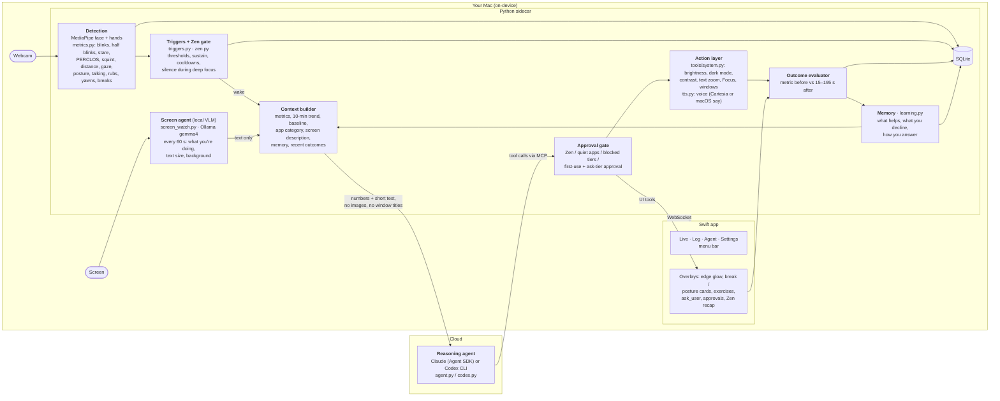

# eyeOS

An eye-strain coach for macOS. See [SPEC.md](SPEC.md).

## Architecture

eyeOS has two AI models (the **screen agent** and the **reasoning agent**). Everything around them is fast,
deterministic code. Detection, deciding when to wake the agent, the safety gate and judging whether an action
helped all happen without an LLM. The models only interpret context and choose actions.



| Part | What it is | Runs | Code |
|---|---|---|---|
| **Detection** | Signal processing, not an LLM. MediaPipe face and hand landmarks at camera rate feed a rolling-window engine that turns them into eye and posture metrics, and logs events (blinks, rubs, yawns, breaks). | on-device, every frame | `vision.py`, `metrics.py` |
| **Screen agent** | A local vision model. Every 60 s, while you're at the screen, it describes what you're doing ("editing Python in VS Code, small text, dark background", whether it's long reading, whether listening could replace looking). | on-device, Ollama | `screen_watch.py` |
| **Triggers + Zen gate** | Rules that decide *when* the reasoning agent wakes: thresholds with a sustain time, cooldowns, a gap between runs (eye rubs and leaning in skip the gap), and a heartbeat. In Zen everything still records, but nothing wakes the agent. | on-device | `triggers.py`, `zen.py` |
| **Reasoning agent** | The LLM. It gets the context, writes a short rationale, then picks the least disruptive action (or none), escalating only when earlier actions didn't help. | Claude Agent SDK or Codex CLI (your own login) | `agent.py`, `codex.py`, `mcp_bridge.py` |
| **Approval gate** | Code between the agent and every action: blocks visible actions in Zen and quiet apps, honors blocked tools, and asks you first on a tool's first use or when it's set to "ask". | on-device | `agent.py` `call_tool` |
| **Action layer** ("action / voice agent") | Executes what the agent chose. macOS changes (brightness, dark mode, contrast, Focus, text zoom, window size), Swift overlays (edge glow, 20-20-20 card, posture card, guided exercises, questions), and voice (reads a page aloud, or speaks a summary written by the local model). It's not a separate LLM. | on-device | `tools/system.py`, `Overlays.swift`, `tts.py` |
| **Outcome evaluator** | About 3 min after each action, compares its target metric before vs after (e.g. blink rate) → improved / neutral / worse; break suggestions check whether you really looked away. | on-device | `agent.py` `evaluate_outcome` |
| **Memory** | Learned rules from the last 14 days (what tends to help, what rarely helps, what you decline, whether you usually say "not now"), plus rules the agent saves. Sent with every run. | on-device | `learning.py` |

**One cycle.** You stop blinking. Detection reports a low blink rate, and the trigger fires after it lasts 2 min. The
context builder adds your baseline, the trend, "coding in VS Code" from the screen agent, and memory ("the edge-glow
blink reminder tends to help this user"). The reasoning agent picks `remind_to_blink`. The gate sees it's already
approved, and the glow pulses. About 3 min later the evaluator scores it, and memory updates its counts.

**Privacy boundary.** Camera frames and screenshots never leave the Mac. The cloud model receives numbers, the app
name and category, the local model's short screen description and your memory rules. It never gets images, window
titles or page text. Spoken text goes to Cartesia only if you set a Cartesia key; otherwise macOS `say` speaks it on-device.

## Run

```sh
cd sidecar && uv sync && mkdir models && ./scripts/fetch_models.sh   # once
cd ../app && ./scripts/build_app.sh && open build/eyeOS.app
```

The app spawns the Python sidecar (`uv run … python -m eyeos`). The reasoning agent uses your own CLI login: Claude through the Claude Agent SDK (its bundled `claude`, or `ANTHROPIC_API_KEY` from Settings → Keys), or Codex through `codex exec` (pick in Settings → Agent). The screen agent needs [Ollama](https://ollama.com) with a vision model (`ollama pull gemma4`) and Screen Recording permission for eyeOS. Without them the agent just works without a screen description. The Cartesia key is optional: without it, voice uses macOS `say`.

No Xcode needed: the app is a SwiftPM package wrapped into a `.app` by `build_app.sh`.

First launch opens a short setup: welcome (grants the camera), sit at arm's length (3 s), follow the dot (10 s). The 60 s blink baseline then runs in the background; the Live header shows its progress. Keys, other permissions and Focus Shortcuts are optional and live in Settings.

Each rebuild re-signs the app ad hoc, so macOS asks once for Keychain access to the saved keys. Click **Always Allow**; until you do, the app waits at launch with no window.

## Testing setup

**In the app.** Pick one:
- Settings → Demo → **Run setup again**: the full flow.
- Settings → Camera → **Recalibrate**, or the "Not calibrated" pill in the Live header: calibration steps only.
- As a true first run: `defaults delete dev.eyeos.app onboarded`, then relaunch. Add `tccutil reset Camera dev.eyeos.app` to see the camera prompt again.

Check that **Start** stays disabled until "Face found" shows, each step shows a progress ring and moves on by itself, a full-screen dot visits the center and four corners in step 2, and after **Start using eyeOS** the Live header counts down "Learning your normal blink rate" and then shows an eye score. Cover the camera during a step to see the failure and **Try again**.

**Without the UI.** Drive steps 1–3 against a second sidecar with a throwaway database. It needs camera access for your terminal, and stdin must stay open, because the sidecar exits on stdin EOF:

```sh
cd sidecar
sleep 300 | uv run python -m eyeos --port 8799 --token t --db /tmp/eyeos-test.db &
uv run python scripts/check_setup.py 8799 t   # prints done/failed + the calibration result per step
pkill -f "eyeos --port 8799"
```

## Zen mode

After `zen.enter_min` (default 10) minutes of sustained focus, eyeOS goes silent: no agent runs, overlays or sounds, and the menu bar shows a plain eye. Sustained focus means eyes on screen, active input, a work app in front and no real break. Metrics keep recording. Zen ends on a real break, being away, going idle, switching to a non-work app, or a call. A recap card then lists what happened while eyeOS stayed silent: blink-rate change, eye rubs, time too close to the screen, posture drift, squinting, and every alert it held back. The same recap appears on the Log page. Start or end it by hand from the Live header, the menu bar or Settings. See SPEC §9.11.

## Sidecar only

```sh
cd sidecar
uv run python -m eyeos --print                      # live metrics at 2 Hz
uv run python -m eyeos --record out.jsonl.gz        # Ctrl-C to stop
uv run python -m eyeos --replay out.jsonl.gz --print
uv run pytest
```

Running from a terminal makes macOS attribute the camera to the terminal app.

## Deviations from the spec

- Agent: Claude Agent SDK (`claude-agent-sdk`) with in-process MCP tools instead of the raw Messages API; the §9.2 gate runs inside each tool handler.
- Camera: always the Mac's built-in camera (never a Continuity Camera iPhone).
- Contrast / transparency / motion / cursor toggles go through user-created Shortcuts (`eyeOS Contrast On`, …): `defaults write com.apple.universalaccess` is refused on this macOS (R2).
- MediaPipe runs in VIDEO mode on a dedicated thread instead of LIVE_STREAM.
- `tests/fixtures/session_a.jsonl.gz` is not recorded yet; the fixture test is skipped until it exists (record it with `--record`, following §13, and write `session_a.truth.json`).
