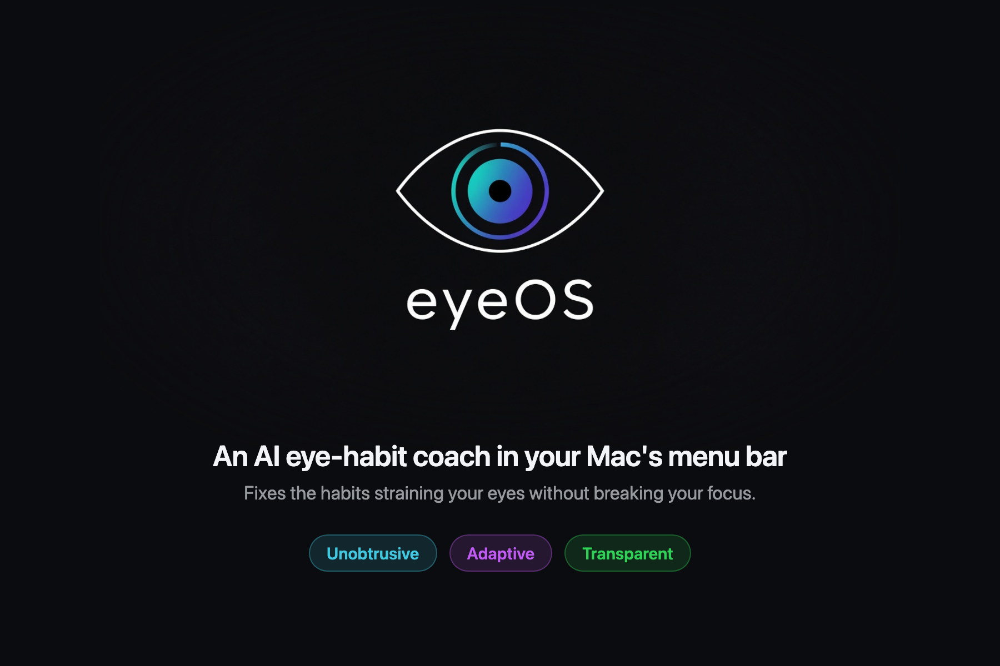
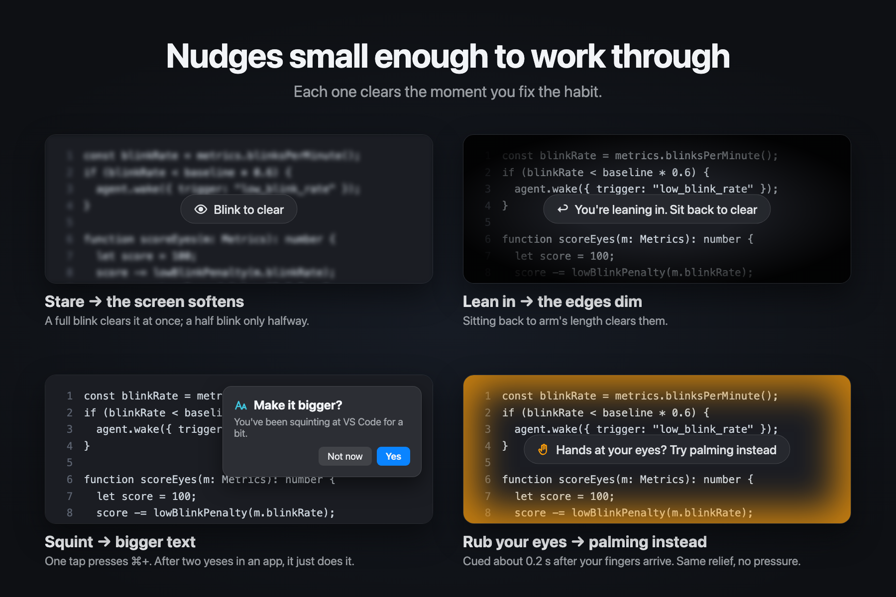
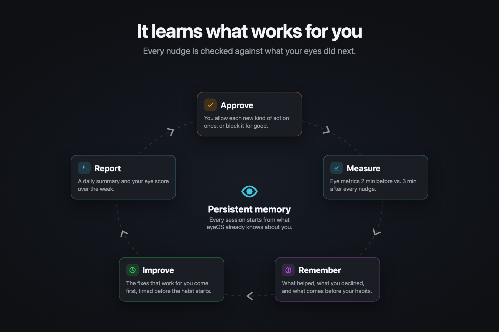
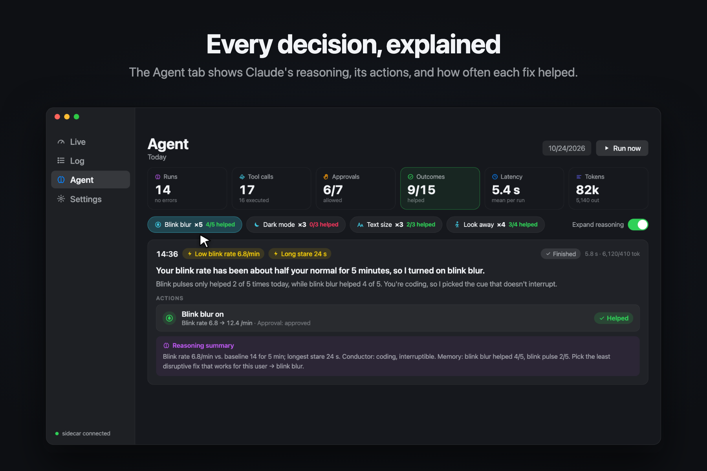
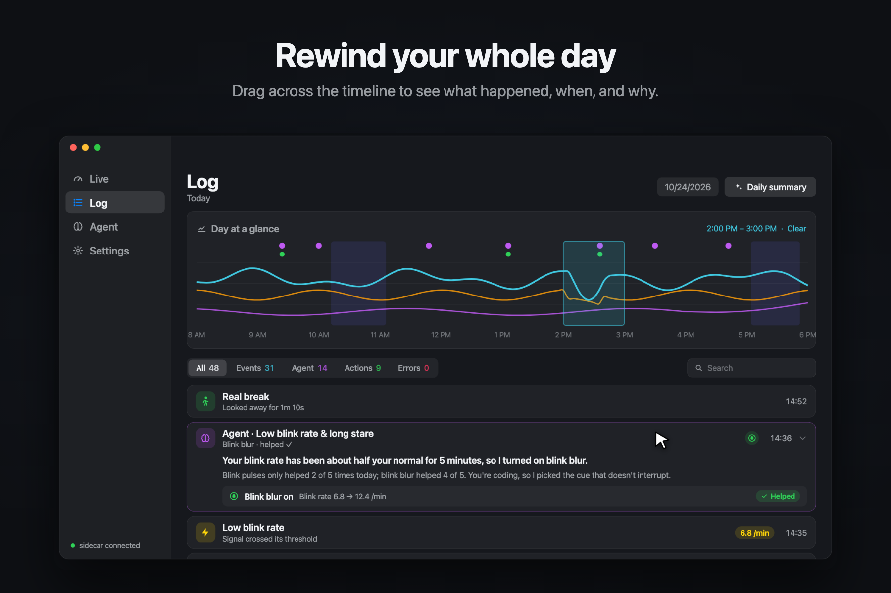
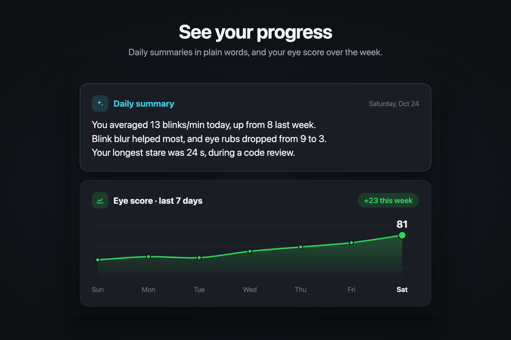
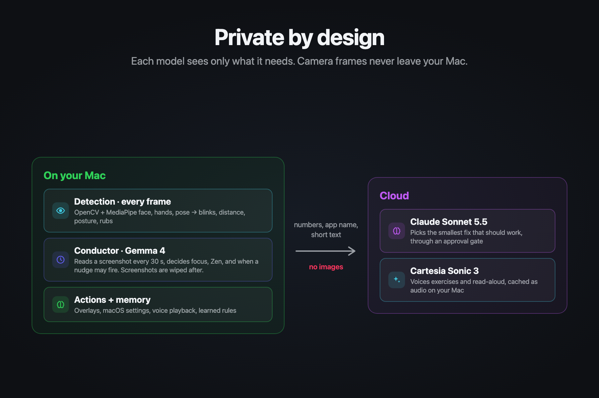
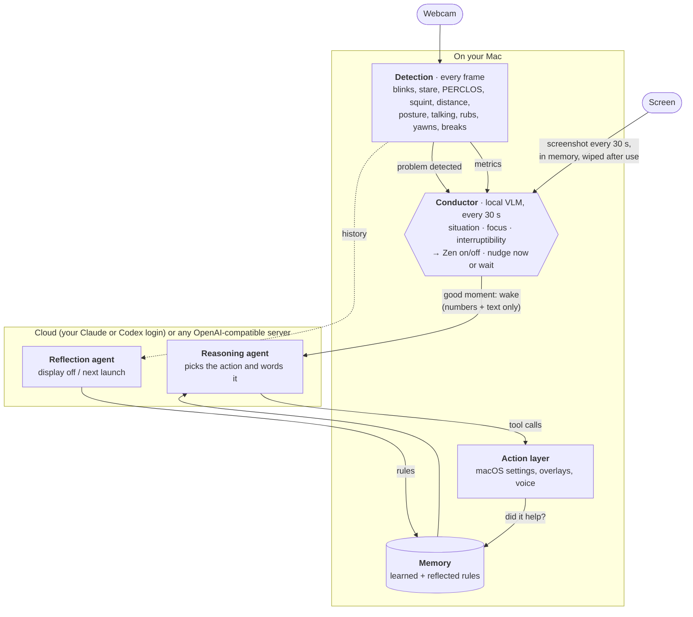

<div align="center">

# eyeOS

**An AI eye-habit coach in your Mac's menu bar that fixes the habits straining your eyes without breaking your focus.**

 🐻 Built in **Cal Hacks 13.0 • ⏱️ 36 hours**

[Inspiration](#inspiration) · [What it does](#what-it-does) · [Architecture](#architecture) · [Built with...](#built-with)

[Install](#install) ([download](https://github.com/walkerhsu/eyeOS/releases/latest)) · [Build from source](#build-from-source) · [Spec](SPEC.md)

**Unique Features:**
[Zen mode](#zen-mode) · [Blink blur](#blink-blur) · [Eye gym](#eye-gym) · [Habit coach](#habit-coach) · [Voice Agent](#voice-cartesia) · [Demo media](#demo-video-and-devpost-media)

[](https://youtu.be/V5lTXN15UJ8)


</div>

### DEMO: https://youtu.be/V5lTXN15UJ8
### Devpost: https://devpost.com/software/eyeos-dzuijy

## Context
Computer vision syndrome, or digital eye strain, is the dry, tired, irritating feeling after hours at a screen. The advice is always the same: blink more, sit back, take more breaks. But when you're even remotely focused, you rarely pay attention to such small habits, and when your job, occupation, and/or passion literally requires you to be in front of a screen all the time, taking 20-minute breaks isn't practical at all.

eyeOS is for people consistently on screens for unhealthy hours daily not by choice, but because their work demands it: students pulling all-nighters, engineers, IT, accountants, and anyone at a desk all day. 

eyeOS follows three core design principles: **unobtrusive**, **adaptive**, and **transparent**.

The name is literal. By definition, an operating system (OS) schedules work and manages resources. eyeOS schedules rest, and manages brightness, dark mode, and contrast.

## What it does

The camera and MediaPipe turn each frame into insights and metrics that later inform agent decisions: blinks, half-blinks, stares, distance from screen, posture, rubs, yawns, and a dark room against a bright display. **All fused into a live 0–100 eye score.**

### Nudges small enough to work through



Fixes happen in the moment and clear as soon as the habit does: stare and the screen softens until you blink, lean in and the edges dim until you sit back, squint and eyeOS offers bigger text, reach to rub your eyes and it offers palming instead. When more is needed, Claude Sonnet 5.5 picks the smallest useful action: change the Mac (brightness, dark mode, contrast, Do Not Disturb), or ask you to rest while a Cartesia voice talks you through eye exercises the camera checks.

### Quiet when you're locked in

A local vision model checks a screenshot about every 30 seconds to work out what you're doing and how interruptible you are. During deep work it turns on **Zen**: measuring continues, nudges wait. When Zen ends, a recap shows what your eyes did while eyeOS stayed silent. **See [Zen mode](#zen-mode).**

### It learns what works for you



Every Claude action passes a code-enforced approval check: each kind of action the first time, the bigger ones every time. Every nudge is then measured against what your eyes did next. Outcomes, declines, and answers become memory rules, a reflection pass writes new ones after each stretch of use, and patterns like *"most of your eye rubs come after 45 minutes without a break"* let eyeOS step in before the habit starts.

### Nothing is a black box





The **Live** page shows your eye score and what's behind it (no camera image). The **Agent** page lists every decision with its reasoning, its actions, and how often each fix helped. The **Log** lets you rewind your day. A menu bar popover and a small floating HUD, which brightens only when something drifts, keep eyeOS in view from any app.



### Private by design



Camera frames never leave the Mac. Screenshots go only to the vision model (on your Mac unless you pick a hosted one), then are wiped. Claude gets numbers, the app name, a short screen description, and your rules: no images or page text. Without a screen description it gets the front window's title instead, and nothing about the screen. Calendar event titles are shared only if you approve calendar access. Details are under [Architecture](#architecture).

*The screenshots above are rendered from [`video/`](video/) and show illustrative data.*

## Architecture

An on-device **conductor** orchestrates eyeOS. It's a local vision model that checks in every 30 s, works out what
you're doing and how interruptible you are, controls Zen, and decides when the cloud reasoning agent may act.
Detection runs continuously underneath it. A reflection agent turns each stretch of use into memory.



| Part | Role | Runs | Code |
|---|---|---|---|
| **Detection** | Signal processing, not an LLM: MediaPipe face and hand landmarks → eye and posture metrics and events. Flags problems (low or frequent blinking, leaning in, rubbing…). | on-device, every frame | `metrics.py`, `triggers.py` |
| **Conductor** (orchestrator) | Local vision model, so private information on your screen doesn't leave the computer. Every ~30 s it reads one screenshot plus the metrics and its previous check, and returns the activity, situation, focus and interruptibility. Automatically turns Zen on and off, and holds nudges during meetings and deep work (rubbing and leaning in still go out). Falls back to rules without a vision model. | on-device with Ollama or a local OpenAI-compatible server; a hosted one works too, but screenshots then leave the Mac | `screen_watch.py`, `zen.py` |
| **Reasoning agent** | The cloud LLM, woken only when the conductor says it's a good moment. Picks the least disruptive action (or none) and writes the message. Every action passes a code-enforced approval check. Claude uses Sonnet 5.5 by default and drops to Haiku 5.5 when Sonnet is slow. | Claude Agent SDK, Codex CLI, or any OpenAI-compatible server | `agent.py`, `codex.py`, `openai_compat.py` |
| **Action layer** | Carries out the choice: brightness, dark mode, contrast, text zoom, Focus, windows; overlays (edge glow, break and posture cards, exercises, questions); voice (read aloud, or a spoken summary made by the vision model). | on-device | `tools/system.py`, `Overlays.swift`, `tts.py` |
| **Memory** | Rules sent with every run: learned from outcomes, declines and answers (what helps, what you dislike), plus what reflection writes. | on-device | `learning.py` |
| **Reflection agent** | When the display turns off (or at the next launch, after a shutdown), reviews the unreflected stretch by hour and by situation, and writes a summary, 2–4 rules and one thing to try. | reasoning agent, numbers only | `reflection.py` |

**Privacy.** Camera frames never leave the Mac. Screenshots are captured into memory, never written to disk, shown
only to the vision model, and wiped after each check. If you point vision at an OpenAI-compatible server that isn't on this
Mac, Settings warns that screenshots leave the Mac; spoken summaries use the same server, so page text goes there too.
The cloud model gets numbers, the app name, the conductor's short text and memory rules: no images or page text. The
conductor's text goes along only while it is recent and actually describes the screen; otherwise the agent gets the front
window's title instead (when Automation is allowed) and no screen field or screen tools at all. If you approve the calendar tool, it also sees the titles of your next few events. Voice uses macOS `say`
unless you add a Cartesia key.

## Built with:

| Layer | Tools |
|---|---|
| Mac app | SwiftUI (Live, Log, Agent, and Settings pages, menu bar extra, HUD, overlays), SwiftPM |
| On-device | Python sidecar over a token-authenticated localhost WebSocket, OpenCV, MediaPipe Face / Hand / Pose, Gemma 4 via Ollama as the conductor, SQLite |
| Cloud | Claude Agent SDK on Claude Sonnet 5.5 (Codex CLI or any OpenAI-compatible server also work), Cartesia Sonic 3 for voice |
| System actions | macOS display settings, Shortcuts for contrast and Focus |

## Install

Requires a Mac with Apple Silicon and macOS 14 or later.

1. Download `eyeOS-<version>-arm64.dmg` from the [latest release](https://github.com/walkerhsu/eyeOS/releases/latest), open it and drag **eyeOS** into **Applications**.
2. If this build isn't notarized, clear the download flag once in Terminal, or macOS refuses to open it (or blocks its
   built-in Python):
   ```sh
   xattr -dr com.apple.quarantine /Applications/eyeOS.app
   ```
3. Open eyeOS. Setup walks you through the rest, and macOS only asks for a permission when you click **Grant**:
   - **Camera** (required) and a 20-second calibration.
   - **Connect your AI** (optional):
     - **AI coach:** click **Sign in with Claude** to sign in in a Terminal window, or use an Anthropic API key.
       Codex (your ChatGPT login) or any OpenAI-compatible server works too. **Test** checks it end to end.
     - **Screen awareness:** step 1, install the free [Ollama](https://ollama.com/download) app; step 2, click
       **Download**. The model downloads in the background, and eyeOS starts Ollama by itself.
   - **Allow what you want** (optional): Screen Recording, Accessibility, Automation, each with a **Grant** button.
   - **Natural voice** (optional, in Settings): a Cartesia key. Without one, eyeOS uses the built-in macOS voice.

Everything after the camera can wait: it all stays at the top of **Settings → Setup**. Without the AI coach eyeOS
still measures and runs the habit coach; without screen awareness, Zen uses simpler rules.

The app carries everything else it needs: its own Python, MediaPipe models and the `claude` CLI. Your data stays in
`~/Library/Application Support/eyeOS`.

## Build from source

For development, the app runs the sidecar straight from the repo with uv:

```sh
cd sidecar && uv sync && ./scripts/fetch_models.sh   # once
cd ../app && ./scripts/build_app.sh && open build/eyeOS.app
```

The app spawns the Python sidecar (`uv run … python -m eyeos`). No Xcode needed: the app is a SwiftPM package wrapped
into a `.app` by `build_app.sh`.

**Packaging for others.** `app/scripts/package_app.sh` builds the self-contained app and a DMG:

```sh
cd app && ./scripts/package_app.sh            # → build/eyeOS-0.1.0-arm64.dmg
EYEOS_VERSION=0.2.0 ./scripts/package_app.sh  # set the version
```

It embeds a relocatable CPython 3.11 (python-build-standalone, via uv), installs the sidecar's locked dependencies from
`uv.lock` into it, copies `sidecar/eyeos` and the MediaPipe models, precompiles everything, checks that the sidecar
imports, then signs and makes the DMG. The app is about 800 MB, and the DMG about 370 MB; the `claude` CLI that ships with claude-agent-sdk
is the biggest part. It builds for the architecture of the Mac you run it on.

By default the app is signed ad hoc, so people who download it need the `xattr` step above. With an Apple Developer ID
it is signed with the hardened runtime (`scripts/eyeOS.entitlements`), and with a notarytool profile it is also
notarized and stapled, so it opens with a double-click:

```sh
xcrun notarytool store-credentials eyeos --apple-id you@example.com --team-id TEAMID   # once
SIGN_IDENTITY="Developer ID Application: Your Name (TEAMID)" NOTARY_PROFILE=eyeos ./scripts/package_app.sh
```

**Agent providers.** Claude runs through the Claude Agent SDK (its bundled `claude`, signed in with `claude auth login`
or an Anthropic API key), Codex through `codex exec`. Pick in Settings → Agent.

**OpenAI-compatible servers (local LLMs).** Both the agent and the screen check can use any server that speaks the
OpenAI Chat Completions API: LM Studio, Ollama's `/v1`, llama.cpp, MLX (`mlx_lm.server`), vLLM, OpenAI, OpenRouter, or
a custom URL. Pick it in Settings → Agent → Provider and Settings → Privacy → Vision server. Presets fill in the base URL,
and the list button shows the server's models. The agent model needs tool calling and the vision model needs image
input. Each role has its own optional API key in the Keychain, so the agent's key never reaches the vision server.
With Ollama as the agent server, raise its context (`OLLAMA_CONTEXT_LENGTH=16384`), because its default can be too short
for the agent's input.

First launch opens a short setup: welcome (grants the camera), sit at arm's length (3 s), follow the dot (10 s), blink 3
times (up to 8 s), then the setup checklist. The 60 s blink baseline then runs in the background; the Live header shows
its progress.

Each ad-hoc rebuild changes the app's signature, so macOS asks once for Keychain access to any saved keys. Click
**Always Allow**; until you do, the app waits at launch with no window. Developer ID builds keep the same identity
across versions and don't ask again.

## Testing setup

**In the app.** Pick one:
- Settings → Setup → **Run setup again**: the full flow.
- Settings → Camera → **Recalibrate**, or the "Not calibrated" pill in the Live header: calibration steps only.
- As a true first run: `defaults delete dev.eyeos.app onboarded`, then relaunch. Add `tccutil reset Camera dev.eyeos.app` to see the camera prompt again.

Check that **Start** stays disabled until "Face found" shows, each step shows a progress ring and moves on by itself when it succeeds (a weak result offers **Continue anyway** or **Try again**), a full-screen dot visits the center and four corners in step 2, step 3 ticks off each of your 3 blinks, and after **Start using eyeOS** the Live header counts down "Learning your normal blink rate" and then shows an eye score. Cover the camera during a step to see the failure and **Try again**.

**Without the UI.** Drive the same steps (distance, gaze, blink check, then the 60 s baseline) against a second sidecar with a throwaway database. It needs camera access for your terminal, and stdin must stay open, because the sidecar exits on stdin EOF:

```sh
cd sidecar
sleep 300 | uv run python -m eyeos --port 8799 --token t --db /tmp/eyeos-test.db &
uv run python scripts/check_setup.py 8799 t   # prints done/failed + the calibration result per step
pkill -f "eyeos --port 8799"
```

# Unique Features

## Zen mode

After `zen.enter_min` (default 10) minutes of sustained focus, eyeOS goes silent: no agent runs, overlays or sounds, and the menu bar shows a plain eye. Sustained focus means your eyes are on the screen, there's no call and no real break, and the conductor saw deep focus (and no meeting) in at least 3 of its last 4 checks. Without a vision model it falls back to active input and a work app in front. Metrics keep recording.

Automatic Zen ends on a real break, being away, a call or meeting, or three checks in a row without deep focus. Going idle ends it too, unless the conductor still sees deep focus (reading without typing). Without the conductor, switching to a non-work app also ends it. Zen you start by hand lasts until you end it or a call starts.

If Zen lasted at least a minute and didn't end because you walked away, a recap card lists what happened while eyeOS stayed silent: blink-rate change, eye rubs, time too close to the screen, posture drift, squinting, and how many alerts it held back (with the top three kinds). The same recap appears on the Log page. Start or end Zen by hand from the Live header, the menu bar or Settings. See SPEC §9.11.

## Blink blur

Stare at the screen for 8 s without blinking and it slowly goes soft. A full blink clears it at once; a half blink
only clears half, which teaches full blinks. It's off during Zen, calls, video, quiet apps and exercises. Toggle it and
set the strength in Settings → Camera. The agent can also turn it on, off, up or down
(`set_blink_blur`, asks you each time unless you set it to auto in Settings → Advanced → Tools). Its effect on blink rate is measured like any other action, so the agent
learns whether blur helps you. The sidecar computes the level (`blur.py`, sent as
`blur` in `metrics`); the app draws a click-through frosted pane (`Overlays.swift`).

## Eye gym

Guided exercises are checked by the camera and coached by voice as they happen (`gym.py`):

- **Blinks:** counts full blinks aloud and calls out half ones.
- **Palming:** catches peeking. Hands over the eyes or a lost face count as covered.
- **Follow the dot:** scores how closely your eyes follow a moving dot, from the correlation between gaze and dot position, so it needs no calibration. If your head turns instead of your eyes, it tells you.

Focus shift isn't checked, because a webcam can't see where your eyes focus. Spoken reactions are synthesized when the
exercise starts (Cartesia, or `say`), so they play without delay and still work on slow Wi‑Fi. Each result
("8 full blinks · 2 half", "Tracking accuracy 78%") is logged and becomes the tool call's result, so the agent and the
Log page can see it.

## Habit coach

Eye habits are mostly unconscious, so telling someone "don't" rarely sticks. The coach follows habit reversal:
notice the habit as it starts, swap it for something harmless, fix what drives it, and show progress (`habits.py`).

| Habit | What eyeOS sees | What it does |
|---|---|---|
| Rubbing your eyes | Fingertips at an eye while your eyes close (`metrics.py`) | A soft "tink" about 0.2 s in, with an amber glow and a short line that stay up until you open your eyes. Then an offer to swap the rub for 20 s of palming (same relief, no pressure, checked by the camera) |
| Pulling or tugging at lashes | The same touch, but the fingertip stays put instead of sweeping across the eye | The same cue and swap |
| Leaning in | You've been closer than 80% of your calibrated distance for 30 s | The screen edges slowly darken; sitting back clears them |
| Squinting at small text | Squinting for 5 s in an editor, browser or notes app | "Make it bigger?" One tap presses ⌘+. After two yeses in an app, it does it by itself |

**Only the eyes.** People touch their faces about 20 times an hour, mostly harmlessly. Cueing all of that would
just get muted, so the coach only cues reaches to the eyes, where rubbing and pulling do harm.

**No false alarms from everyday touching.** From a single camera, fingers twirling hair in front of your eye look
just like a rub. What gives a rub away is the eye: rubbing or pulling at your lashes shuts it, while hair play, a
chin or cheek in your hand, or pushing up your glasses leave both eyes open. In recordings, the touched eye's
openness was about 0.3 for rubs and lash pulls and about 1.0 for everything else. So a touch only counts while
your eyes are closing, and a fingertip nearer the nose bridge than the eye (glasses) never counts. On those
recordings this caught every rub and lash pull, about 0.2–0.3 s after the fingers arrived, with no cue for hair,
chin or normal work. While a hand is near your eyes, hands are tracked on every frame instead of every third, so
the cue isn't late. To check or tune it on your own recordings, see `sidecar/scripts/habit_report.py`.

We tried cueing *before* contact, by predicting where the hand was heading. It gave almost no head start (rubs
arrive fast) and it caused every false alarm, so the coach waits for a touch with the eyes closing.

**What comes before the habit.** Each rub saves what was going on: time since a break, blink rate, the longest
stare, how long the session has run, and the time of day. Learning compares that with your screen time overall,
and turns a clear pattern into a memory rule the agent reads, e.g. *"Most of this user's eye rubs (7 of 9) come
after 45+ min without a real break."* The agent then acts before the urge, and leaves the instant responses to the
coach.

The coach is silent in Zen, calls, meetings and exercises, but it still counts. The Today tile shows rubs against
your 7-day average and how many you swapped.

## Voice (Cartesia)

Eye rest means looking away from the screen or closing your eyes, so eyeOS can't count on you reading anything
then. Voice keeps working: it's how eyeOS coaches you and reads to you while your eyes rest.

**Setup.**
1. Create an API key at [play.cartesia.ai](https://play.cartesia.ai).
2. Paste it into Settings → Setup → Voice and click **Save** (eyeOS restarts its sidecar). The key is kept in the macOS
   Keychain and passed to the sidecar as `CARTESIA_API_KEY`. It is never written to the repo.

Without a key, everything still works using macOS `say`, on-device.

**Where Cartesia is used** (`sidecar/eyeos/tts.py`):

| Where | What it says | Why it has to be voice |
|---|---|---|
| Eye gym (`agent.py`, `gym.py`) | Step instructions; "keep going, 20 seconds to go" reminders; live reactions to what the camera sees ("Four.", "That one was only half", "I can see you peeking", "Eyes only, keep your head still") | Your eyes are closed or following a dot |
| `summarize_aloud` | A 4–6 sentence summary of the current page, written by the vision model (on the Mac by default) | Rest your eyes and still get the gist |
| `switch_to_audio` | The current Safari or Chrome tab, or the selected text, read aloud | Long reading with tired eyes |

**Cartesia features used:**
- Sonic-3 text-to-speech (`tts.bytes`, 24 kHz 16-bit WAV).
- The voices API (`voices.list`), to pick a default voice.
- `generation_config.speed`, controlled by the `audio.speed` setting.

**Making it feel instant:**
- Every clip is cached on disk, keyed by voice, speed and text.
- When an exercise starts, all its possible reactions are synthesized in parallel, so a reaction plays as soon as
  the camera sees something. Cached lines keep working on slow or dropped Wi‑Fi.
- Long text is split into chunks, and the next chunk is synthesized while the current one plays.
- A reaction only plays in a gap, so it never cuts off an instruction.

**Privacy.** Cartesia only receives text to be spoken: exercise scripts, fixed reaction phrases, summaries made by
your vision model, and pages you explicitly ask to hear. It never receives camera frames or screenshots.

**Known limitations.**
- Clips aren't streamed: each chunk is synthesized fully before it plays. Short lines are cached and play at once,
  but reading a long page aloud starts after the first chunk (up to about 600 characters) is ready.
- With a key set but no network, lines that aren't cached fail silently. The exercise overlay still runs; only the
  voice is missing.
- There's no voice picker in the UI yet. It uses the voice in the `audio.voice_id` setting, or the first voice the
  API lists.
- Voice only goes one way: you can't talk back to eyeOS yet.

## Sidecar only

```sh
cd sidecar
uv run python -m eyeos --print                      # live metrics at 2 Hz
uv run python -m eyeos --record out.jsonl.gz        # Ctrl-C to stop
uv run python -m eyeos --replay out.jsonl.gz --print
uv run pytest
```

Running from a terminal makes macOS attribute the camera to the terminal app.

<!-- ## Deviations from the spec

- Agent: Claude Agent SDK (`claude-agent-sdk`) with in-process MCP tools instead of the raw Messages API; the §9.2 gate runs inside each tool handler.
- Camera: always the Mac's built-in camera (never a Continuity Camera iPhone).
- Contrast / transparency / motion / cursor toggles go through user-created Shortcuts (`eyeOS Contrast On`, …): `defaults write com.apple.universalaccess` is refused on this macOS (R2).
- MediaPipe runs in VIDEO mode on a dedicated thread instead of LIVE_STREAM.
- `tests/fixtures/session_a.jsonl.gz` is not recorded yet; the fixture test is skipped until it exists (record it with `--record`, following §13, and write `session_a.truth.json`). -->
