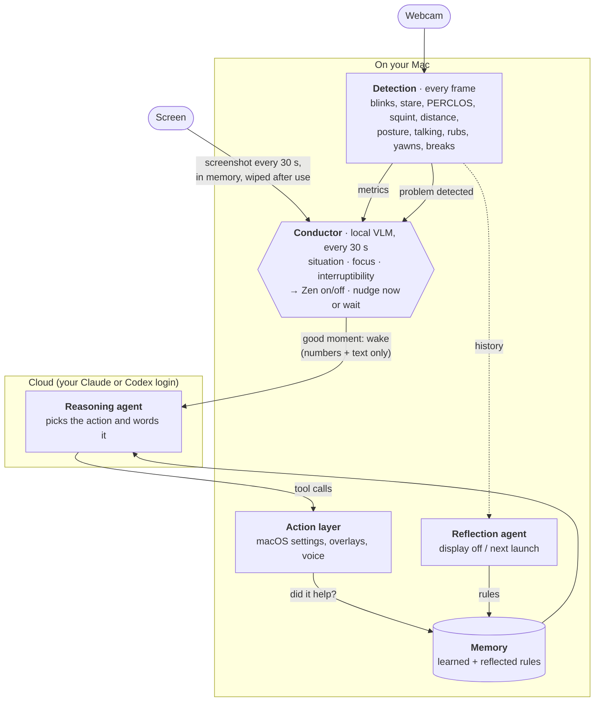

# eyeOS

An eye-strain coach for macOS. See [SPEC.md](SPEC.md).

## Architecture

An on-device **conductor** orchestrates eyeOS. It's a local vision model that checks in every 30 s, works out what
you're doing and how interruptible you are, controls Zen, and decides when the cloud reasoning agent may act.
Detection runs continuously underneath it. A reflection agent turns each stretch of use into memory.



| Part | Role | Runs | Code |
|---|---|---|---|
| **Detection** | Signal processing, not an LLM: MediaPipe face and hand landmarks → eye and posture metrics and events. Flags problems (low or frequent blinking, leaning in, rubbing…). | on-device, every frame | `metrics.py`, `triggers.py` |
| **Conductor** (orchestrator) | Local vision model. Every 30 s it reads one screenshot plus the metrics and its previous check, and returns the activity, situation, focus and interruptibility. Turns Zen on and off, and holds nudges during meetings and deep work (rubbing and leaning in still go out). Falls back to rules without Ollama. | on-device, Ollama | `screen_watch.py`, `zen.py` |
| **Reasoning agent** | The cloud LLM, woken only when the conductor says it's a good moment. Picks the least disruptive action (or none) and writes the message. Every action passes a code-enforced approval check. | Claude Agent SDK or Codex CLI | `agent.py`, `codex.py` |
| **Action layer** | Carries out the choice: brightness, dark mode, contrast, text zoom, Focus, windows; overlays (edge glow, break and posture cards, exercises, questions); voice (read aloud, or a spoken summary made by the local model). | on-device | `tools/system.py`, `Overlays.swift`, `tts.py` |
| **Memory** | Rules sent with every run: learned from outcomes, declines and answers (what helps, what you dislike), plus what reflection writes. | on-device | `learning.py` |
| **Reflection agent** | When the display turns off (or at the next launch, after a shutdown), reviews the unreflected stretch by hour and by situation, and writes a summary, 2–4 rules and one thing to try. | reasoning agent, numbers only | `reflection.py` |

**Privacy.** Camera frames never leave the Mac. Screenshots are captured into memory, never written to disk, shown
only to the local model, and wiped after each check. The cloud model gets numbers, the app name, the conductor's
short text and memory rules: no images, window titles or page text. Voice uses macOS `say` unless you add a Cartesia key.

## Run

```sh
cd sidecar && uv sync && mkdir models && ./scripts/fetch_models.sh   # once
cd ../app && ./scripts/build_app.sh && open build/eyeOS.app
```

The app spawns the Python sidecar (`uv run … python -m eyeos`). The reasoning agent uses your own CLI login: Claude through the Claude Agent SDK (its bundled `claude`, or `ANTHROPIC_API_KEY` from Settings → Keys), or Codex through `codex exec` (pick in Settings → Agent). The screen agent needs [Ollama](https://ollama.com) with a vision model (`ollama pull gemma4`) and Screen Recording permission for eyeOS. Without them the agent just works without a screen description. The Cartesia key is optional: without it, voice uses macOS `say`.

No Xcode needed: the app is a SwiftPM package wrapped into a `.app` by `build_app.sh`.

First launch opens a short setup: welcome (grants the camera), sit at arm's length (3 s), follow the dot (10 s). The 60 s blink baseline then runs in the background; the Live header shows its progress. Keys, other permissions and Focus Shortcuts are optional and live in Settings.

Each rebuild re-signs the app ad hoc, so macOS asks once for Keychain access to the saved keys. Click **Always Allow**; until you do, the app waits at launch with no window.

## Testing setup

**In the app.** Pick one:
- Settings → Demo → **Run setup again**: the full flow.
- Settings → Camera → **Recalibrate**, or the "Not calibrated" pill in the Live header: calibration steps only.
- As a true first run: `defaults delete dev.eyeos.app onboarded`, then relaunch. Add `tccutil reset Camera dev.eyeos.app` to see the camera prompt again.

Check that **Start** stays disabled until "Face found" shows, each step shows a progress ring and moves on by itself, a full-screen dot visits the center and four corners in step 2, and after **Start using eyeOS** the Live header counts down "Learning your normal blink rate" and then shows an eye score. Cover the camera during a step to see the failure and **Try again**.

**Without the UI.** Drive steps 1–3 against a second sidecar with a throwaway database. It needs camera access for your terminal, and stdin must stay open, because the sidecar exits on stdin EOF:

```sh
cd sidecar
sleep 300 | uv run python -m eyeos --port 8799 --token t --db /tmp/eyeos-test.db &
uv run python scripts/check_setup.py 8799 t   # prints done/failed + the calibration result per step
pkill -f "eyeos --port 8799"
```

## Zen mode

After `zen.enter_min` (default 10) minutes of sustained focus, eyeOS goes silent: no agent runs, overlays or sounds, and the menu bar shows a plain eye. Sustained focus means eyes on screen, active input, a work app in front and no real break. Metrics keep recording. Zen ends on a real break, being away, going idle, switching to a non-work app, or a call. A recap card then lists what happened while eyeOS stayed silent: blink-rate change, eye rubs, time too close to the screen, posture drift, squinting, and every alert it held back. The same recap appears on the Log page. Start or end it by hand from the Live header, the menu bar or Settings. See SPEC §9.11.

## Sidecar only

```sh
cd sidecar
uv run python -m eyeos --print                      # live metrics at 2 Hz
uv run python -m eyeos --record out.jsonl.gz        # Ctrl-C to stop
uv run python -m eyeos --replay out.jsonl.gz --print
uv run pytest
```

Running from a terminal makes macOS attribute the camera to the terminal app.

## Deviations from the spec

- Agent: Claude Agent SDK (`claude-agent-sdk`) with in-process MCP tools instead of the raw Messages API; the §9.2 gate runs inside each tool handler.
- Camera: always the Mac's built-in camera (never a Continuity Camera iPhone).
- Contrast / transparency / motion / cursor toggles go through user-created Shortcuts (`eyeOS Contrast On`, …): `defaults write com.apple.universalaccess` is refused on this macOS (R2).
- MediaPipe runs in VIDEO mode on a dedicated thread instead of LIVE_STREAM.
- `tests/fixtures/session_a.jsonl.gz` is not recorded yet; the fixture test is skipped until it exists (record it with `--record`, following §13, and write `session_a.truth.json`).
